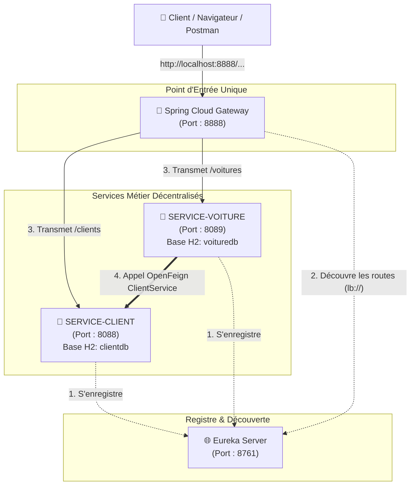
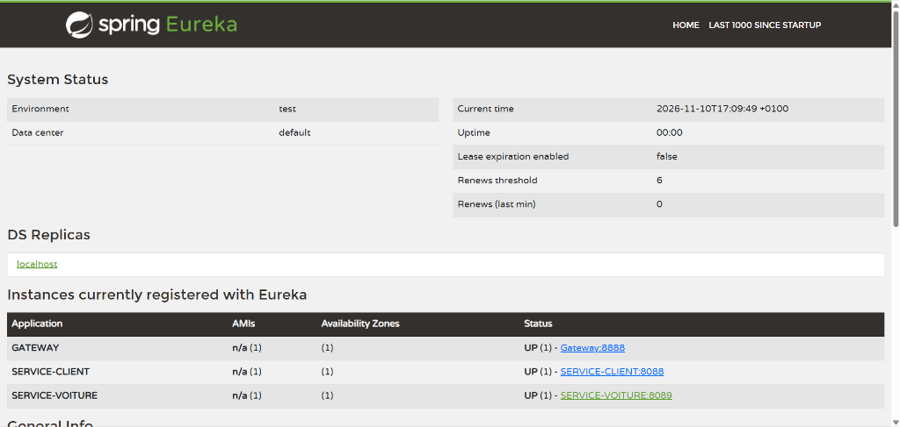
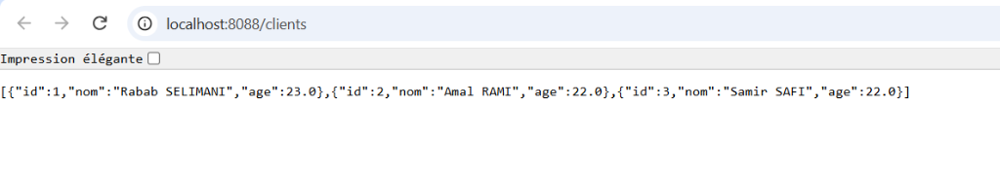
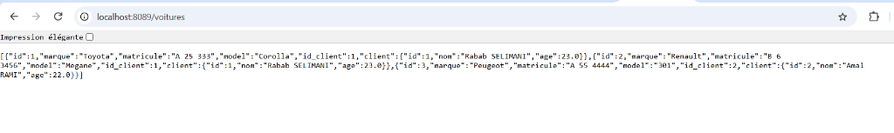
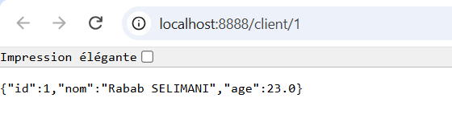
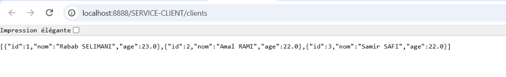
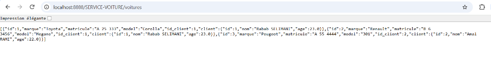

# TP 19 : Orchestration de microservices avec Spring Cloud : Eureka, Gateway et OpenFeign

Ce projet met en œuvre une architecture **microservices distribuée complète** orchestrée avec **Spring Cloud**. Il illustre l'enregistrement et la découverte dynamique des services avec **Netflix Eureka**, le routage unifié (statique et dynamique) avec **Spring Cloud Gateway**, ainsi que la communication inter-services déclarative et synchrone avec **OpenFeign**.

---

## 🎯 Objectifs Pédagogiques

1. **Découverte de services (Service Discovery)** : Configurer et déployer un serveur d'enregistrement **Netflix Eureka Server** (`http://localhost:8761/`) et y enregistrer les microservices via `spring-cloud-starter-netflix-eureka-client`.
2. **API Gateway & Routage Unifié** : Implémenter **Spring Cloud Gateway** (`http://localhost:8888/`) comme point d'entrée unique de l'architecture, avec :
   - Routage statique par fichier YAML (`application.yml`).
   - Routage programmatique via le bean `RouteLocator` (`lb://SERVICE-CLIENT`, `lb://SERVICE-VOITURE`).
   - Découverte dynamique automatique par nom de service via `DiscoveryClientRouteDefinitionLocator` (`http://localhost:8888/SERVICE-CLIENT/...`).
3. **Communication Inter-Microservices Déclarative** : Utiliser **Spring Cloud OpenFeign** (`@FeignClient`) dans `SERVICE-VOITURE` pour consommer de façon transparente les données du `SERVICE-CLIENT` avec résolution dynamique d'adresses et équilibrage de charge côté client (**Spring Cloud LoadBalancer**).
4. **Persistance et Données Isolées** : Chaque microservice gère sa propre source de données en mémoire (**H2 Database**) avec **Spring Data JPA** et initialise son jeu de test via un `CommandLineRunner`.

---

## 🏗️ Architecture Globale du Système



---

## 📂 Structure du Projet Multi-Modules

```text
Tp19/
├── pom.xml                                           # POM Aggregateur configurant les modules
├── README.md                                         # Documentation complète et guide d'exécution
├── screenshots/                                      # Captures d'écran d'exécution réelles
│   ├── 01_eureka_dashboard_instances.png            # Tableau de bord Eureka avec les instances UP
│   ├── 02_service_client_all.png                    # Microservice Client direct (http://localhost:8088/clients)
│   ├── 03_service_voiture_all.png                   # Microservice Voiture direct avec Feign (http://localhost:8089/voitures)
│   ├── 04_gateway_static_client_1.png               # Gateway Statique / lb:// (http://localhost:8888/client/1)
│   ├── 05_gateway_dynamic_service_client.png        # Gateway Dynamique (http://localhost:8888/SERVICE-CLIENT/clients)
│   └── 06_gateway_dynamic_service_voiture.png       # Gateway Dynamique (http://localhost:8888/SERVICE-VOITURE/voitures)
│
├── eureka-server/                                    # [Port : 8761] Registre de Découverte
│   ├── pom.xml
│   └── src/main/
│       ├── java/ma/tp/eureka/
│       │   └── EurekaServerApplication.java          # @EnableEurekaServer
│       └── resources/
│           └── application.properties                # Configuration standalone (ne s'enregistre pas auprès d'Eureka)
│
├── service-client/                                   # [Port : 8088] Microservice Client CRUD
│   ├── pom.xml
│   └── src/main/
│       ├── java/ma/tp/client/
│       │   ├── ClientApplication.java                # Point d'entrée & CommandLineRunner d'initialisation H2
│       │   ├── entities/
│       │   │   └── Client.java                       # Entité JPA (@Entity, Long id, String nom, Float age)
│       │   ├── repositories/
│       │   │   └── ClientRepository.java             # Interface Spring Data JPA
│       │   └── controllers/
│       │       └── ClientController.java             # Endpoints GET /clients et GET /client/{id}
│       └── resources/
│           └── application.properties                # Port 8088, spring.application.name=SERVICE-CLIENT, H2 console
│
├── service-voiture/                                  # [Port : 8089] Microservice Voiture avec Feign
│   ├── pom.xml
│   └── src/main/
│       ├── java/ma/tp/voiture/
│       │   ├── VoitureApplication.java               # @EnableDiscoveryClient, @EnableFeignClients & CommandLineRunner
│       │   ├── models/
│       │   │   └── Client.java                       # POJO miroir pour désérialisation de SERVICE-CLIENT
│       │   ├── entities/
│       │   │   └── Voiture.java                      # Entité JPA (id, marque, matricule, model, id_client, @Transient Client)
│       │   ├── services/
│       │   │   ├── ClientService.java                # @FeignClient(name="SERVICE-CLIENT") clientById(@PathVariable id)
│       │   │   └── VoitureService.java               # Service métier d'enregistrement et consultation
│       │   ├── repositories/
│       │   │   └── VoitureRepository.java            # Interface JpaRepository avec findByIdClient(Long id)
│       │   └── controllers/
│       │       └── VoitureController.java            # CRUD complet, injection Feign et mapping des clients
│       └── resources/
│           └── application.properties                # Port 8089, spring.application.name=SERVICE-VOITURE, H2 console
│
└── gateway/                                          # [Port : 8888] Spring Cloud Gateway
    ├── pom.xml
    └── src/main/
        ├── java/ma/tp/gateway/
        │   └── GatewayApplication.java               # RouteLocatorBuilder (lb://...) & DiscoveryClientRouteDefinitionLocator
        └── resources/
            ├── application.properties                # Port 8888, spring.application.name=Gateway
            ├── application.yml                       # Configuration des routes statiques (Étape 5)
            └── app.yml                               # Variante statique archivée lors de l'activation dynamique
```

---

## 🚀 Ordre de Démarrage Recommandé

Pour un fonctionnement optimal de l'enregistrement et de la résolution inter-services, démarrer les applications dans l'ordre suivant :

1. **`EurekaServerApplication`** (Port `8761`) : Attendre que le registre soit prêt.
2. **`ClientApplication`** (Port `8088`) : S'enregistre dans Eureka sous `SERVICE-CLIENT` et peuple sa base H2.
3. **`GatewayApplication`** (Port `8888`) : Découvre le registre Eureka et initialise ses routes.
4. **`VoitureApplication`** (Port `8089`) : S'enregistre dans Eureka sous `SERVICE-VOITURE`, contacte `SERVICE-CLIENT` via OpenFeign et insère les voitures de démo.

---

## 📸 Captures d'Écran d'Exécution et Tests de Validation

### 1. Eureka Server (`http://localhost:8761/`)
Vérification de la présence et de l'état opérationnel des microservices dans le registre Eureka :



* **Validation** : Les microservices `GATEWAY` (port 8888), `SERVICE-CLIENT` (port 8088) et `SERVICE-VOITURE` (port 8089) sont tous présents avec le statut **`UP`** dans le tableau de bord Eureka.

---

### 2. Accès Direct aux Microservices

#### A. SERVICE-CLIENT (Port 8088)
- **`http://localhost:8088/clients`** : Récupération de l'ensemble des clients enregistrés en base H2.
- **`http://localhost:8088/client/1`** : Consultation d'un client par son identifiant unique.



* **Validation** : La liste JSON des 3 clients initialisés par le `CommandLineRunner` (`Rabab SELIMANI`, `Amal RAMI`, `Samir SAFI`) est renvoyée avec succès (statut HTTP 200).

#### B. SERVICE-VOITURE (Port 8089)
- **`http://localhost:8089/voitures`** : Consultation de toutes les voitures enrichies avec leurs clients.
- **`http://localhost:8089/voitures/1`** : Consultation d'une voiture spécifique.
- **`http://localhost:8089/voitures/client/1`** : Liste des véhicules appartenant au client ID 1.



* **Validation** : Communication inter-microservices réussie via **OpenFeign** (`ClientService`). Pour chaque voiture retournée, l'attribut `client` est automatiquement peuplé via l'appel distant adressé à `SERVICE-CLIENT` :
  - Voiture 1 (Toyota Corolla) $\rightarrow$ Client 1 (`Rabab SELIMANI`)
  - Voiture 2 (Renault Megane) $\rightarrow$ Client 1 (`Rabab SELIMANI`)
  - Voiture 3 (Peugeot 301) $\rightarrow$ Client 2 (`Amal RAMI`)

---

### 3. Accès à travers la Gateway (Port 8888)

#### A. Routage Statique et Programmatique (`RouteLocator` / `lb://`)
- **`http://localhost:8888/clients`** : Routage transparent vers `SERVICE-CLIENT`.
- **`http://localhost:8888/client/1`** : Consultation du client 1 via la Gateway.
- **`http://localhost:8888/voitures`** : Routage transparent vers `SERVICE-VOITURE`.



* **Validation** : La requête adressée à la Gateway sur le port `8888` (`/client/1`) est résolue via Eureka (`lb://SERVICE-CLIENT`), transmise de manière transparente et retourne les données du client (`{"id":1,"nom":"Rabab SELIMANI","age":23.0}`).

#### B. Routage Dynamique Automatique (`DiscoveryClientRouteDefinitionLocator`)
- **`http://localhost:8888/SERVICE-CLIENT/clients`** : Découverte dynamique basée sur le nom de service Eureka.
- **`http://localhost:8888/SERVICE-VOITURE/voitures`** : Découverte dynamique de `SERVICE-VOITURE`.





* **Validation** : Le bean `DiscoveryClientRouteDefinitionLocator` configure automatiquement des routes dynamiques pour tout service actif dans Eureka sans aucune déclaration manuelle dans le code ou dans le fichier de configuration YAML.

---

## 🧪 Tests Complémentaires avec cURL

```bash
# Test d'ajout d'une nouvelle voiture pour le client 3 (Samir SAFI) via la Gateway
curl -X POST http://localhost:8888/voitures/3 \
  -H "Content-Type: application/json" \
  -d '{"marque":"Dacia","matricule":"C 10 9999","model":"Sandero"}'

# Test de mise à jour d'un véhicule via la Gateway
curl -X PUT http://localhost:8888/voitures/1 \
  -H "Content-Type: application/json" \
  -d '{"marque":"Toyota Hybrid","matricule":"A 25 333","model":"Corolla GR"}'
```
